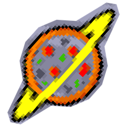
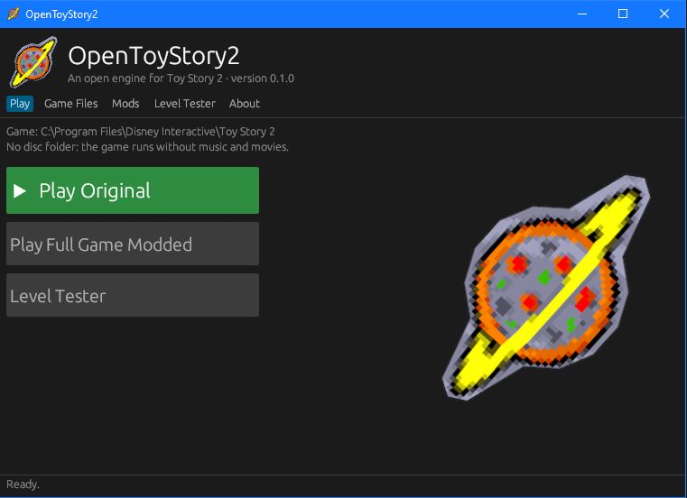
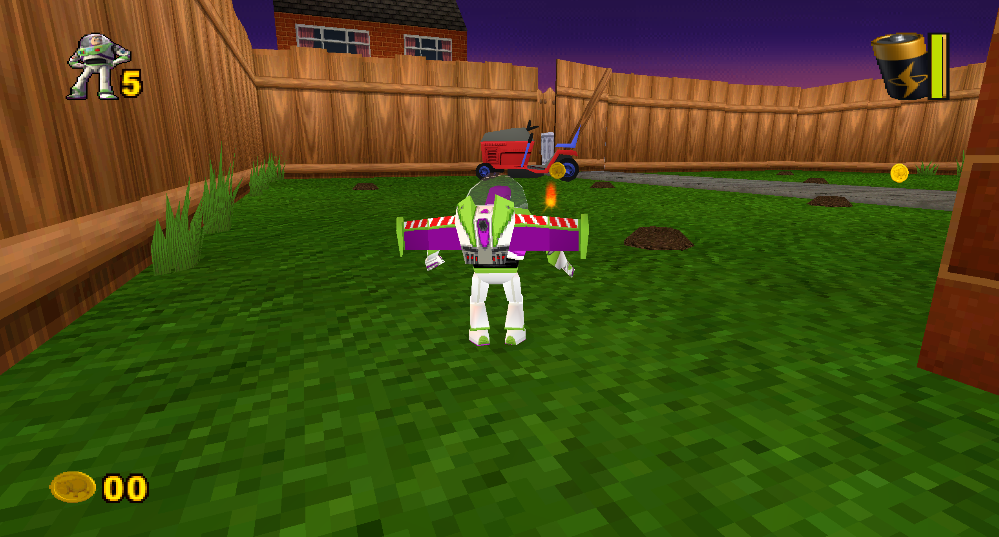
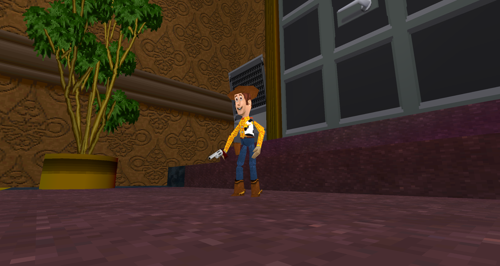

# OpenToyStory2

**Toy Story 2: Buzz Lightyear to the Rescue, rebuilt in Rust.**

OpenToyStory2 is a free, fan-made remake of the engine behind the 1999 PC game *Toy Story 2: Buzz Lightyear to the Rescue*. It plays the game you already own, the same levels, characters, music and movies, on a modern Windows PC, and adds things the original never had, like mods.

It doesn't include the game itself, original files can be found here (abandonware): https://www.myabandonware.com/game/disney-pixar-toy-story-2-buzz-lightyear-to-the-rescue-bfq

**Beta.** All 15 levels can be played from start to finish, but levels 2 to 15 are still being tested and polished. Expect the odd bug.

## What you get

- **The whole game.** Every level from Andy's House to Zurg's Spaceship, the bosses, the races and challenges, the level-select map, the movies and the original soundtrack.
- **Made for modern PCs.** It runs in a resizable widescreen window at your display's resolution, smoothly on high refresh rate screens, with mouse look in first person.
- **Your saves still work.** Saves use the original game's format, so you can carry them over in either direction.
- **A friendly launcher.** It finds your installed game for you, sets up the music and movies from your disc or disc image, and lets you jump straight into any level.
- **Mods.** Play as Woody with a revolver, as one of Zurg's bouncing robots or as the giant Tin Man boss, or turn first person into a full shooter. You turn mods on and off with a tick box.

## Getting started

You'll need:

- A Windows PC.
- The original PC game *Toy Story 2: Buzz Lightyear to the Rescue*, installed from its disc.
- Optional: the game disc, a copy of it or a disc image (`.iso`), for the music and movies.

Then:

1. Download the latest `OpenToyStory2-setup.exe` from the [Releases page](https://github.com/opents2-project/OpenToyStory2/releases) and run it. It installs just for you and doesn't need administrator rights.
2. Open **OpenToyStory2** from the Start menu.
3. The launcher looks for your game. If it can't find it, open **Game Files** and point it at the folder that has `toy2.exe` in it. To get music and movies, also choose your disc or disc image under **Disc folder**.
4. Press **Play**.

Your settings and mods are kept in `%APPDATA%\OpenToyStory2` and your saves in `%APPDATA%\ts2-rust`. Uninstalling leaves both behind, so you won't lose anything.

## Controls

| Key | What it does |
|---|---|
| W A S D | Move (arrow keys in menus) |
| Space | Jump; press again in the air to double jump |
| E | Spin attack (hold to charge it up); in the air, stomp |
| Left mouse button | Fire the wrist laser (hold to charge) |
| Q | First person: look around with the mouse; X locks on to a target |
| Escape | Pause menu; back in menus |
| M | Music on or off |
| V | Switch between the original camera and a free camera |

## Mods

Mods come with the launcher. Open the **Mods** tab, tick the ones you want and press **Play Full Game Modded**. You can also try them on a single level with the **Level Tester**.

| Mod | What it does |
|---|---|
| **Play as Woody** | Run through the game as Woody, with Buzz's moves and a cowboy revolver. Press Q for first person: you see Woody's hand holding the gun, and you can run, jump and climb while you aim. |
| **First-Person Mod** | Play the whole game through Buzz's eyes, as a first-person shooter: run, jump, climb poles and ride zip lines without leaving first person. |
| **Play as Zurg's robot** | Bounce through the levels as one of Zurg's red spring robots. |
| **Play as the Tin Man** | Stomp around as the giant level 1 boss and knock out anything you walk into. |

Want to make your own? Mods are small text files that point at the game's own characters and objects. See the [modding guide](mods/README.md).

## Questions

**Do I need the original game?**
Yes. OpenToyStory2 contains none of the game's levels, characters, sounds, music or movies. They're all loaded from your copy when you play. Cannot host the game for legal reasons.

**Is this official?**
No. It's an unofficial project made by fans, and it isn't affiliated with or endorsed by Disney, Pixar, Traveller's Tales or Activision.

**How was it made?**
The original game's workings were reverse engineered and then written again from scratch in the Rust programming language. None of the original program code is used. Claude Opus 5.5 used extensively. 

**Does it work on Mac or Linux?**
Not yet. Windows only for now.

**I found a bug.**
Please [open an issue](https://github.com/opents2-project/OpenToyStory2/issues) and say which level you were on and what happened. A screenshot really helps.

## Credits

OpenToyStory2 is made by **lewiloon2k/asmerdon** and contributors, and inspired by [OpenMW](https://openmw.org), the open-source engine for Morrowind.

*Toy Story 2: Buzz Lightyear to the Rescue* was developed by Traveller's Tales and published by Activision. Toy Story and its characters are the property of Disney and Pixar.

## For developers

Want to build it yourself, run the tests or see how things work inside? Start with [docs/developing.md](docs/developing.md). It covers running from source, building the installer, the detailed status and the differences from the original. The ground rules and architecture are in [PROJECT.md](PROJECT.md), and the day-to-day working notes are in [HANDOFF.md](HANDOFF.md).
